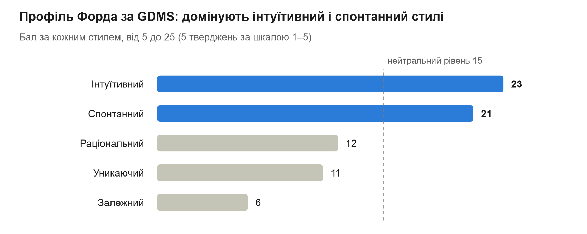

# Стиль прийняття рішень Г. Форда за GDMS — графік

Графік до індивідуального завдання з прийняття управлінських рішень (рис. 3.1). Його генерує скрипт `gdms_profile_chart.py` з оцінок 25 тверджень опитувальника GDMS (С. Скотт і Р. Брюс, 1995) із табл. 3.1. Форд не міг пройти опитувальник сам, тому оцінки поставлено замість нього на підставі його книги та історичних досліджень.



Бал за кожним із п'яти стилів дорівнює сумі оцінок п'яти тверджень за шкалою 1–5, тобто може бути від 5 до 25. Пунктир позначає нейтральний рівень 15 балів (5 тверджень × середина шкали 3). Синім виділено стилі з балом вище цього рівня. Скрипт визначає їх сам, і від них же залежить заголовок.

Форд передусім інтуїтивний (23) і спонтанний (21) керівник. Раціональний (12) і уникаючий (11) стилі виражені слабко, а залежний (6) майже відсутній: рішення він ухвалював швидко, за відчуттям і сам.

## Запуск

```bash
pip install matplotlib
python gdms_profile_chart.py            # збереже PNG у поточну папку
python gdms_profile_chart.py --out img  # збереже PNG у папку img/
```

Скрипт також виводить у консоль бал за кожним стилем. Щоб змінити оцінки, відредагуйте словник `SCORES` на початку файлу. Суми, порядок стовпців і виділення перерахуються автоматично.

Шрифт береться перший доступний зі списку Inter → Arial → Liberation Sans → DejaVu Sans. Усі вони підтримують кирилицю.
